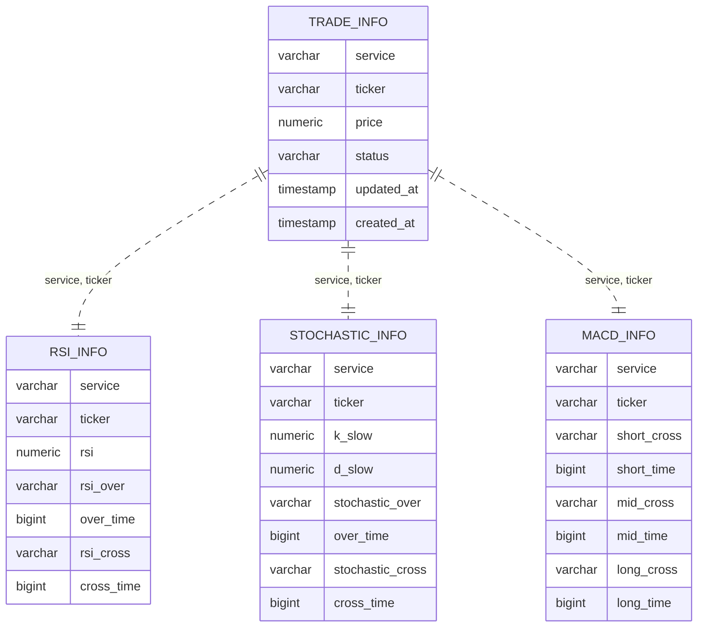

# 기존 DB 스키마

기존 AutoTrader(업비트 봇)가 사용하던 PostgreSQL 스키마를 정리한 문서입니다.

> 기존 저장소에는 DDL(스키마 파일)이 없습니다.
> 이 문서는 `modules/trade_repository.py`의 쿼리와 코드에서 넣는 값을 기준으로 정리했으며,
> **컬럼 타입과 제약 조건은 코드에서 추정한 것**입니다.

---

## 목차

1. [테이블 구성](#1-테이블-구성)
2. [ERD](#2-erd)
3. [테이블 정의](#3-테이블-정의)
4. [상태 값](#4-상태-값)
5. [읽기 / 쓰기 시점](#5-읽기--쓰기-시점)
6. [한계](#6-한계)

---

## 1. 테이블 구성

| 테이블 | 역할 |
|--------|------|
| `TRADE_INFO` | 티커별 마지막 매매 상태 (매수/매도, 평단가) |
| `RSI_INFO` | 티커별 RSI 마지막 과매수/과매도 진입, 마지막 크로스 |
| `STOCHASTIC_INFO` | 티커별 스토캐스틱 마지막 과매수/과매도 진입, 마지막 크로스 |
| `MACD_INFO` | 티커별 MACD short / mid / long 마지막 크로스 |

- 4개 테이블 모두 `(service, ticker)`당 1행입니다. (`service`: `upbit` / `bithumb`, `ticker`: `BTC/KRW` 형식)
- 이력 없이 **최신 상태만 덮어씁니다.**

---

## 2. ERD

테이블 간 FK는 없고, 같은 `(service, ticker)` 값으로만 연결됩니다.

---

## 3. 테이블 정의

`*_time` 컬럼은 이벤트가 발생한 **캔들의 시작 시각(epoch milliseconds)** 입니다.

### 3.1 `TRADE_INFO`

| 컬럼 | 타입 | 설명 |
|------|------|------|
| `service` | varchar | 거래소 |
| `ticker` | varchar | 티커 |
| `price` | numeric | 평단가. 매수 시 현재가, 추가 매수 시 `(기존 평단 + 현재가) / 2`, 매도 시 매도 시점 현재가 |
| `status` | varchar | 마지막 매매: `bid`(매수) / `ask`(매도). 초기값 NULL |
| `updated_at` | timestamp | 매매 시 `NOW()` |
| `created_at` | timestamp | 행 생성 시각 |

### 3.2 `RSI_INFO`

| 컬럼 | 타입 | 설명 |
|------|------|------|
| `service`, `ticker` | varchar | |
| `rsi` | numeric | 마지막 이벤트 시점의 RSI 값 |
| `rsi_over` | varchar | 마지막 과매수/과매도 진입 |
| `over_time` | bigint | `rsi_over` 캔들 시각 |
| `rsi_cross` | varchar | RSI와 RSI 시그널(EMA 9)의 마지막 크로스 |
| `cross_time` | bigint | `rsi_cross` 캔들 시각 |

### 3.3 `STOCHASTIC_INFO`

| 컬럼 | 타입 | 설명 |
|------|------|------|
| `service`, `ticker` | varchar | |
| `k_slow` | numeric | 마지막 이벤트 시점의 slow %K |
| `d_slow` | numeric | 마지막 이벤트 시점의 slow %D |
| `stochastic_over` | varchar | 마지막 과매수/과매도 진입 (%K, %D 모두 기준선 초과/미만) |
| `over_time` | bigint | `stochastic_over` 캔들 시각 |
| `stochastic_cross` | varchar | %K와 %D의 마지막 크로스 |
| `cross_time` | bigint | `stochastic_cross` 캔들 시각 |

### 3.4 `MACD_INFO`

| 컬럼 | 타입 | 설명 |
|------|------|------|
| `service`, `ticker` | varchar | |
| `short_cross` / `short_time` | varchar / bigint | MACD short (EMA short − EMA mid) 와 시그널의 마지막 크로스 |
| `mid_cross` / `mid_time` | varchar / bigint | MACD mid (EMA short − EMA long) 와 시그널의 마지막 크로스 |
| `long_cross` / `long_time` | varchar / bigint | MACD long (EMA mid − EMA long) 와 시그널의 마지막 크로스 |

MACD 값 자체는 저장하지 않고 크로스 방향만 저장합니다.

---

## 4. 상태 값

`constants/constants.py`에 정의된 문자열을 저장합니다.

| 컬럼 | 값 |
|------|----|
| `*_over` | `OVER_BOUGHT`, `OVER_SOLD`, NULL |
| `*_cross` | `GOLDEN_CROSS`, `DEAD_CROSS`, NULL |
| `TRADE_INFO.status` | `bid`, `ask`, NULL |

NULL은 "아직 이벤트 없음" 또는 "초기화(refresh)됨"을 뜻합니다.

**과매수/과매도 기준** (`config.upbit.json`)

| 지표 | 과매도 | 과매수 |
|------|--------|--------|
| RSI | 31 미만 | 60 초과 |
| Stochastic (%K, %D 모두) | 25 미만 | 75 초과 |

---

## 5. 읽기 / 쓰기 시점

### 5.1 쓰기

| 시점 | 대상 | 내용 |
|------|------|------|
| 서버 시작 (`init_trade`) | 4개 테이블 | 티커마다 `service`, `ticker`만 넣은 행 INSERT |
| 매 주기 지표 계산 후 | `RSI_INFO`, `STOCHASTIC_INFO`, `MACD_INFO` | 이벤트가 발생한 항목만 UPDATE (발생하지 않으면 이전 값 유지) |
| MACD 3종이 같은 봉에서 모두 데드크로스 | `RSI_INFO`, `STOCHASTIC_INFO` | `*_over`, `*_cross`를 NULL로 초기화 |
| 매수 / 매도 (`refresh`) | `RSI_INFO`, `STOCHASTIC_INFO`, `MACD_INFO` | `*_over`, `*_cross`를 NULL로 초기화 (`*_time`, 값 컬럼은 유지) |
| 매수 / 매도 (`update_trade_info`) | `TRADE_INFO` | `price`, `status`, `updated_at` 갱신 |

### 5.2 읽기

매 주기 티커마다 4개 테이블을 각각 조회해 매수·매도 조건을 판단합니다.

| 조건 | 사용하는 컬럼 |
|------|---------------|
| 신규 매수 | `rsi_over`, `rsi_cross`, `stochastic_over`, `stochastic_cross`, `k_slow`, `d_slow`, MACD 3종 `*_cross` |
| 추가 매수 | `rsi_cross`, `stochastic_over`, `stochastic_cross`, MACD 3종 `*_cross`, `TRADE_INFO.status`, `price` |
| 매도 | `rsi_over`, `stochastic_over`, `rsi_cross`, `stochastic_cross`, `TRADE_INFO.price` (수익률 계산) |

`*_time` 컬럼은 저장만 하고 매매 판단에는 사용하지 않습니다.

---

## 6. 한계

| 구분 | 내용 |
|------|------|
| 이력 없음 | 모든 값을 덮어써서 언제, 어떤 신호로 매매했는지 남지 않음 |
| 포지션 정보 부족 | 보유 수량·매입금액이 없어 평단가를 단순 평균으로 계산. 매수 횟수는 메모리(`Trader.counts`)에만 있음 |
| 주문 결과 없음 | 주문 uuid, 체결가, 수수료를 저장하지 않아 주문 실패나 부분 체결을 알 수 없음 |
| 제약 조건 없음 (추정) | PK가 없으면 재시작 시 `init_trade`가 중복 행을 만들 수 있고, 상태 컬럼에 임의의 문자열이 들어갈 수 있음 |
| 구조 중복 | 같은 구조(메인선이 시그널선을 교차)인 지표를 테이블 3개로 나눠 쿼리와 코드가 중복됨 |
| 값 컬럼의 시점 | `rsi`, `k_slow`, `d_slow`는 현재 값이 아니라 마지막 이벤트 시점의 값 |
