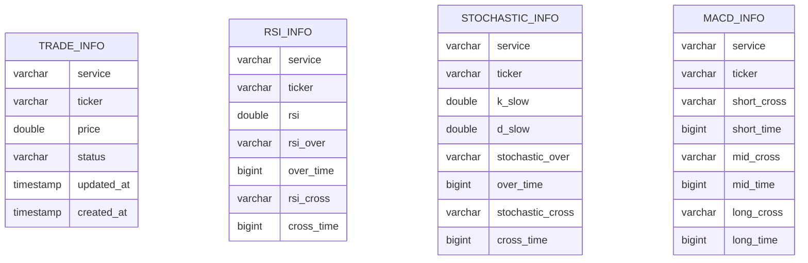
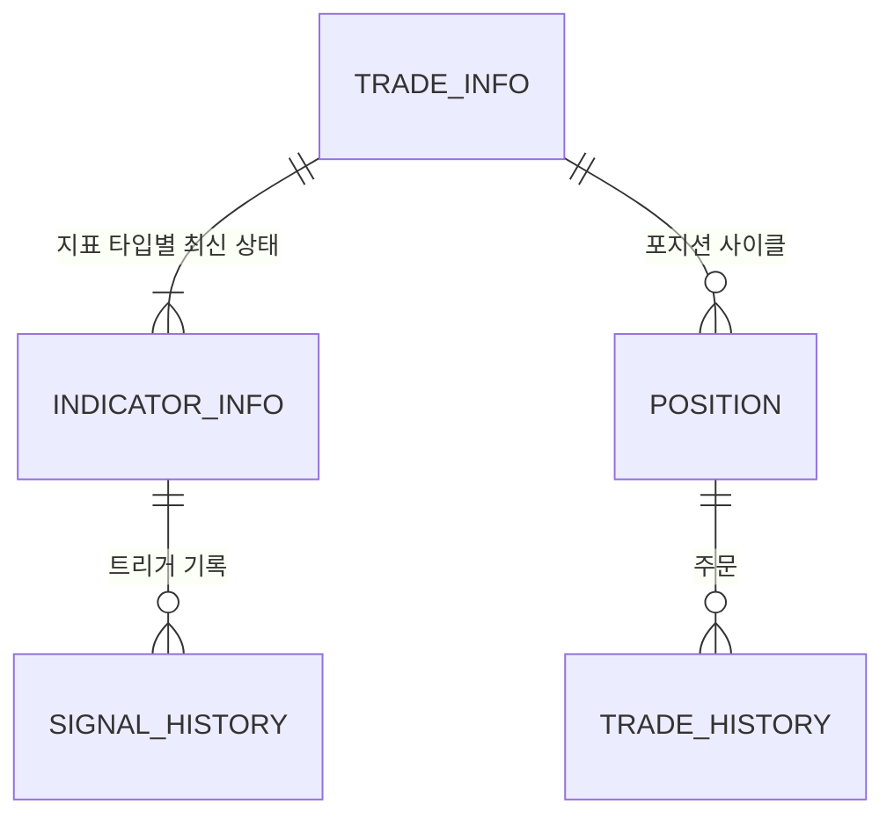

# DB 스키마 변경 내역

기존 AutoTrader DB에서 upbit-bot DB로 바뀐 내용을 정리한 문서입니다.

- 새 스키마: [`db/schema.sql`](../../db/schema.sql)
- ERD: [`db/ERD.md`](../../db/ERD.md)

---

## 목차

1. [요약](#1-요약)
2. [기존 스키마](#2-기존-스키마)
3. [변경된 스키마](#3-변경된-스키마)
4. [테이블별 변경 사항](#4-테이블별-변경-사항)
5. [코드 영향 범위](#5-코드-영향-범위)
6. [마이그레이션](#6-마이그레이션)

---

## 1. 요약

| 구분 | 기존 | 변경 |
|------|------|------|
| 지표 상태 | `RSI_INFO`, `STOCHASTIC_INFO`, `MACD_INFO` 3개 테이블 | `INDICATOR_INFO` 1개 테이블 (`indicator_type`으로 구분) |
| 포지션 | `TRADE_INFO` (가격, 상태만 저장) | `TRADE_INFO`에 수량·매입금액·매수 횟수 추가 |
| 이력 | 없음 (모든 값을 덮어씀) | `SIGNAL_HISTORY`, `POSITION`, `TRADE_HISTORY` 추가 |
| 제약 조건 | 없음 | PK, FK, CHECK, 부분 유니크 인덱스 |
| 트리거 | 없음 | `updated_at` 자동 갱신, 지표 변경 이력 자동 기록 |

**유지한 것**: 지표 이벤트(과매수/과매도 진입, 골든/데드 크로스)가 발생하면 최신 상태를 덮어쓰고,
매수·매도 시 초기화(refresh)하는 기존 매매 로직의 방식은 그대로 유지합니다.

**바꾼 이유**

- 같은 구조(메인선이 시그널선을 교차)인 지표를 테이블 3개로 나눠 쿼리와 코드가 중복됨
- 덮어쓰기만 해서 언제 어떤 신호로 매매했는지 추적·분석 불가
- 평단가를 단순 평균으로 계산했고, 매수 횟수가 메모리(`Trader.counts`)에만 있어 재시작 시 초기화됨
- 주문 결과(uuid, 체결가, 수수료)를 저장하지 않아 주문 실패나 부분 체결을 감지할 수 없음
- 제약 조건이 없어 재시작 시 행 중복, 잘못된 상태 값 저장이 가능함

---

## 2. 기존 스키마

> 기존 저장소에는 스키마 파일이 없어, `modules/trade_repository.py`의 쿼리를 기준으로 정리했습니다.



- 4개 테이블 모두 `(service, ticker)`당 1행이며, 테이블 간 관계(FK)는 없음
- 모든 값은 최신 상태로 덮어쓰기만 함

---

## 3. 변경된 스키마



| 테이블 | 분류 | 행 단위 | 상태 |
|--------|------|---------|------|
| `TRADE_INFO` | 최신 상태 | 티커당 1행 | 변경 |
| `INDICATOR_INFO` | 최신 상태 | 티커 × 지표 타입당 1행 (티커당 5행) | 신규 (3개 테이블 통합) |
| `SIGNAL_HISTORY` | 이력 | 지표 상태 변경 1건당 1행 | 신규 |
| `POSITION` | 이력 | 포지션 1사이클(첫 매수 ~ 전량 매도)당 1행 | 신규 |
| `TRADE_HISTORY` | 이력 | 주문 1건당 1행 | 신규 |
| `RSI_INFO`, `STOCHASTIC_INFO`, `MACD_INFO` | - | - | 삭제 (`INDICATOR_INFO`로 통합) |

컬럼 전체 목록은 [`db/ERD.md`](../../db/ERD.md)를 참고하세요.

---

## 4. 테이블별 변경 사항

### 4.1 `TRADE_INFO`

| 컬럼 | 변경 | 설명 |
|------|------|------|
| `service`, `ticker` | 변경 | 복합 PK 지정 (재시작 시 중복 행 생성 방지) |
| `price` | 유지 | 평단가. 가중평균으로 계산하도록 변경 예정 |
| `status` | 변경 | `CHECK (status IN ('bid', 'ask'))` 추가 |
| `volume` | 추가 | 보유 수량 |
| `total_cost` | 추가 | 총 매입금액 (KRW, 수수료 포함). 가중평균 평단 = `total_cost / volume` |
| `buy_count` | 추가 | 현재 포지션의 매수 횟수. 메모리의 `Trader.counts`를 대체 |
| `updated_at`, `created_at` | 유지 | `created_at` 기본값 `NOW()` |

### 4.2 `RSI_INFO` · `STOCHASTIC_INFO` · `MACD_INFO` → `INDICATOR_INFO`

세 지표 모두 **메인선(`value`)이 시그널선(`signal`)을 교차**하는 구조라 하나의 테이블로 합쳤습니다.
MACD는 short / mid / long 크로스가 각각 있으므로 타입을 3개로 나눴습니다.

**타입별 컬럼 의미**

| `indicator_type` | `value` | `signal` | `over_state` |
|------------------|---------|----------|--------------|
| `RSI` | RSI | RSI signal (EMA 9) | 사용 |
| `STOCHASTIC` | slow %K | slow %D | 사용 |
| `MACD_SHORT` | MACD (EMA short − EMA mid) | MACD signal (EMA 9) | 항상 NULL |
| `MACD_MID` | MACD (EMA short − EMA long) | MACD signal (EMA 9) | 항상 NULL |
| `MACD_LONG` | MACD (EMA mid − EMA long) | MACD signal (EMA 9) | 항상 NULL |

**컬럼 매핑**

| 기존 테이블.컬럼 | → `INDICATOR_INFO` |
|------------------|--------------------|
| `RSI_INFO.rsi` | `value` (`indicator_type = 'RSI'`) |
| `RSI_INFO.rsi_over` / `over_time` | `over_state` / `over_time` |
| `RSI_INFO.rsi_cross` / `cross_time` | `cross_state` / `cross_time` |
| `STOCHASTIC_INFO.k_slow` | `value` (`indicator_type = 'STOCHASTIC'`) |
| `STOCHASTIC_INFO.d_slow` | `signal` |
| `STOCHASTIC_INFO.stochastic_over` / `over_time` | `over_state` / `over_time` |
| `STOCHASTIC_INFO.stochastic_cross` / `cross_time` | `cross_state` / `cross_time` |
| `MACD_INFO.short_cross` / `short_time` | `cross_state` / `cross_time` (`indicator_type = 'MACD_SHORT'`) |
| `MACD_INFO.mid_cross` / `mid_time` | `cross_state` / `cross_time` (`indicator_type = 'MACD_MID'`) |
| `MACD_INFO.long_cross` / `long_time` | `cross_state` / `cross_time` (`indicator_type = 'MACD_LONG'`) |
| (없음) | `signal` — RSI·MACD 시그널 값 (신규) |
| (없음) | `updated_at` — 트리거로 자동 갱신 (신규) |

**제약 조건**

- PK `(service, ticker, indicator_type)`, FK `(service, ticker)` → `TRADE_INFO`
- `indicator_type`, `over_state`, `cross_state`는 정해진 값만 허용 (CHECK)
- MACD 타입은 `over_state`, `over_time`이 반드시 NULL

**장단점**

| 장점 | 단점 |
|------|------|
| refresh, 상태 갱신, 조회 쿼리를 타입만 바꿔 재사용 | `value`, `signal`의 의미가 타입마다 다름 |
| 매매 판단 시 한 번의 조회로 5행을 읽음 | 티커 등록 시 5행을 넣어야 함 |
| 새 지표는 CHECK에 타입만 추가하면 됨 | 지표 고유 값이 생기면 컬럼 또는 JSONB 추가 필요 |
| 이력 테이블과 구조가 같아 트리거 1개로 기록 | |

### 4.3 `SIGNAL_HISTORY` (신규)

`INDICATOR_INFO`가 UPDATE 될 때 트리거(`LOG_INDICATOR_SIGNAL`)가 자동으로 쌓는 지표 상태 변경 로그입니다.

- 과매수/과매도 상태(`OVER`)와 크로스 상태(`CROSS`)가 바뀔 때마다 1행 기록
- 같은 상태 · 같은 캔들로 반복 UPDATE 되면 기록하지 않음
- `signal_state`가 NULL이면 refresh(초기화)로 지워진 것
- 애플리케이션 코드에서 직접 쓰지 않음

### 4.4 `POSITION` (신규)

첫 매수부터 전량 매도까지 한 사이클을 1행으로 기록합니다.

- 누적 수량(`volume`), 매입금액(`total_cost`), 가중평균 평단(`avg_price`), 매수 횟수(`buy_count`)
- 청산 시 `sell_price`, `realized_pnl`, `realized_pnl_rate`, `closed_at` 기록
- 열린 포지션(`status = 'OPEN'`)은 티커당 최대 1개 (부분 유니크 인덱스)
- `status = 'CLOSED'`이면 `closed_at`이 반드시 있어야 함 (CHECK)

### 4.5 `TRADE_HISTORY` (신규)

주문 1건을 1행으로 기록합니다. 업비트 주문 `uuid`로 체결 결과와 대조합니다.

| `reason` | 의미 |
|----------|------|
| `ENTRY` | 신규 매수 |
| `ADD` | 추가 매수 |
| `OVERBOUGHT_EXIT` | RSI·스토캐스틱 과매수로 매도 |
| `DEAD_CROSS_EXIT` | 수익 중 RSI·스토캐스틱 데드크로스로 매도 |
| `STOP_LOSS` | 손절 (추가 예정) |
| `MANUAL` | 수동 처리 |

- `order_state`: `wait` → `done` / `cancel` / `failed`
- `signal_snapshot` (JSONB): 주문 시점의 `INDICATOR_INFO` 상태
- `error_message`: 주문 실패 사유

---

## 5. 코드 영향 범위

기존 `TradeRepository` 메서드가 아래와 같이 바뀝니다.

| 기존 메서드 | 변경 |
|-------------|------|
| `init_trade` | `TRADE_INFO` 1행 + `INDICATOR_INFO` 5행 INSERT |
| `rsi_over`, `stochastic_over` | 타입을 인자로 받는 하나의 메서드로 통합 (`over_state`, `over_time`, `value`, `signal` 갱신) |
| `rsi_cross`, `stochastic_cross`, `macd_short`, `macd_mid`, `macd_long` | 타입을 인자로 받는 하나의 메서드로 통합 (`cross_state`, `cross_time`, `value`, `signal` 갱신) |
| `update_rsi` | 삭제 (`rsi_cross`와 동일한 쿼리) |
| `refresh_rsi`, `refresh_stochastic`, `refresh_macd`, `refresh` | 타입 목록을 받아 `over_state`, `cross_state`를 NULL로 바꾸는 하나의 메서드로 통합 |
| `get_rsi`, `get_stochastic`, `get_macd` | 티커의 5행을 한 번에 읽는 하나의 메서드로 통합 |
| `get_info`, `update_trade_info` | `volume`, `total_cost`, `buy_count` 포함 |
| (신규) | `POSITION`, `TRADE_HISTORY` 생성·갱신 메서드 |

`MacdInfo`, `RsiInfo`, `StochasticInfo` 모델도 `INDICATOR_INFO` 1행에 대응하는 모델 하나로 합칠 수 있습니다.

---

## 6. 마이그레이션

기존 DB를 새 스키마로 옮기는 순서입니다. 아래 SQL은 [2. 기존 스키마](#2-기존-스키마) 구조를 기준으로 작성했습니다.
실행 전에 운영 DB의 실제 구조를 `\d trade_info` 등으로 확인하세요.
특히 기존 `TRADE_INFO`에 PK가 없다면 중복 행을 먼저 정리해야 FK를 만들 수 있습니다.

### 6.1 `TRADE_INFO` 컬럼 추가

`schema.sql`은 `CREATE TABLE IF NOT EXISTS`라서 이미 있는 `TRADE_INFO`에는 새 컬럼이 추가되지 않으므로 먼저 추가합니다.

```sql
BEGIN;
ALTER TABLE TRADE_INFO
    ADD COLUMN IF NOT EXISTS VOLUME     DOUBLE PRECISION NOT NULL DEFAULT 0,
    ADD COLUMN IF NOT EXISTS TOTAL_COST DOUBLE PRECISION NOT NULL DEFAULT 0,
    ADD COLUMN IF NOT EXISTS BUY_COUNT  INTEGER          NOT NULL DEFAULT 0;
COMMIT;
```

### 6.2 새 테이블 생성

```bash
psql -h $DB_HOST -p $DB_PORT -U $DB_USER -d $DB_NAME -f db/schema.sql
```

### 6.3 지표 데이터 이전 및 기존 테이블 삭제

```sql
BEGIN;
INSERT INTO INDICATOR_INFO (SERVICE, TICKER, INDICATOR_TYPE, VALUE, OVER_STATE, OVER_TIME, CROSS_STATE, CROSS_TIME)
SELECT SERVICE, TICKER, 'RSI', RSI, RSI_OVER, OVER_TIME, RSI_CROSS, CROSS_TIME FROM RSI_INFO
ON CONFLICT DO NOTHING;

INSERT INTO INDICATOR_INFO (SERVICE, TICKER, INDICATOR_TYPE, VALUE, SIGNAL, OVER_STATE, OVER_TIME, CROSS_STATE, CROSS_TIME)
SELECT SERVICE, TICKER, 'STOCHASTIC', K_SLOW, D_SLOW, STOCHASTIC_OVER, OVER_TIME, STOCHASTIC_CROSS, CROSS_TIME FROM STOCHASTIC_INFO
ON CONFLICT DO NOTHING;

INSERT INTO INDICATOR_INFO (SERVICE, TICKER, INDICATOR_TYPE, CROSS_STATE, CROSS_TIME)
SELECT SERVICE, TICKER, 'MACD_SHORT', SHORT_CROSS, SHORT_TIME FROM MACD_INFO
UNION ALL
SELECT SERVICE, TICKER, 'MACD_MID', MID_CROSS, MID_TIME FROM MACD_INFO
UNION ALL
SELECT SERVICE, TICKER, 'MACD_LONG', LONG_CROSS, LONG_TIME FROM MACD_INFO
ON CONFLICT DO NOTHING;

DROP TABLE RSI_INFO, STOCHASTIC_INFO, MACD_INFO;
COMMIT;
```

### 6.4 이전 후 확인할 것

- **보유 중인 티커의 포지션 정보**: 기존 DB에는 수량과 매입금액이 없어 `volume`, `total_cost`, `buy_count`가 0으로 들어갑니다.
  `status = 'bid'`인 티커는 업비트 잔고를 기준으로 값을 채우고, `POSITION`에 `OPEN` 행을 만들어야 합니다.
- **이력 테이블**: `SIGNAL_HISTORY`, `POSITION`, `TRADE_HISTORY`는 비어 있는 상태로 시작합니다.
- **`signal` 컬럼**: RSI·MACD의 `signal`은 기존에 저장하지 않았으므로 다음 지표 이벤트부터 채워집니다.
