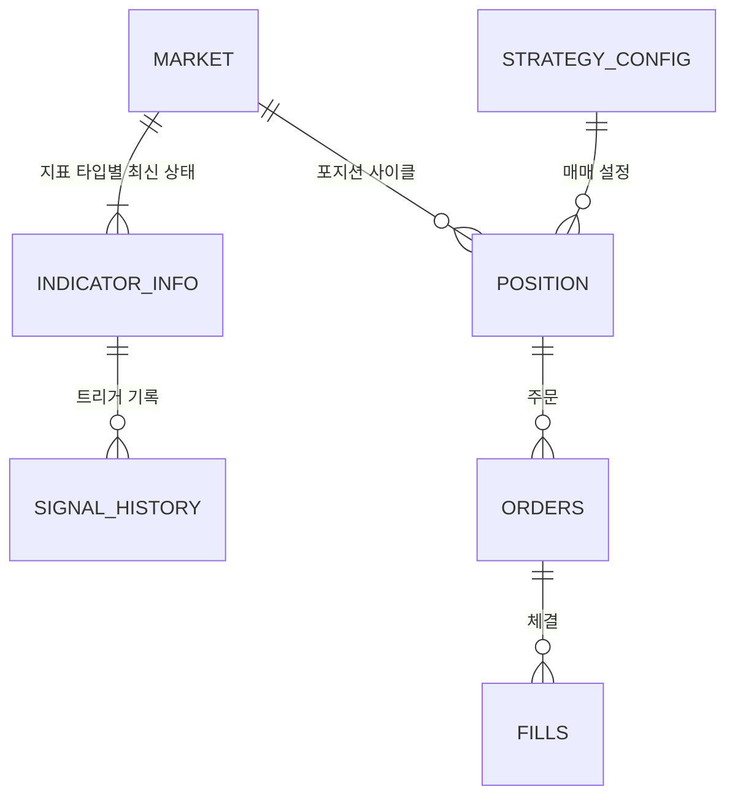

# DB 스키마

upbit-bot이 사용하는 PostgreSQL 스키마를 정리한 문서입니다.
[기존 DB 스키마](legacy-schema.md)의 한계를 해결하고, 거래 시스템·DB 설계에서 일반적으로 권장되는 방법을 반영했습니다.

> DDL: [`db/schema.sql`](../../db/schema.sql) (PostgreSQL 13 이상)

---

## 목차

1. [테이블 구성](#1-테이블-구성)
2. [설계 원칙](#2-설계-원칙)
3. [기존 한계 해결](#3-기존-한계-해결)
4. [ERD](#4-erd)
5. [테이블 정의](#5-테이블-정의)
6. [상태 값](#6-상태-값)
7. [트리거와 검증 뷰](#7-트리거와-검증-뷰)
8. [적용하지 않은 방법](#8-적용하지-않은-방법)

---

## 1. 테이블 구성

| 테이블 | 분류 | 행 단위 | 역할 |
|--------|------|---------|------|
| `MARKET` | 기준 정보 | 마켓당 1행 | 거래 대상 마켓 목록 |
| `STRATEGY_CONFIG` | 기준 정보 | 설정 버전당 1행 | 전략 파라미터(기간, 기준값, 주문 금액) |
| `INDICATOR_INFO` | 최신 상태 | 마켓 × 지표 타입당 1행 | 지표별 현재 값과 마지막 과매수/과매도 진입, 마지막 크로스 |
| `ORDERS` | 거래 원장 | 주문 1건당 1행 | 주문 요청, 거래소 주문 상태, 매매 사유 |
| `FILLS` | 거래 원장 | 체결 1건당 1행 | 실제 체결 가격·수량·금액 |
| `POSITION` | 포지션 | 포지션 1사이클당 1행 | 첫 매수부터 전량 매도까지의 누적 집계와 손익 |
| `SIGNAL_HISTORY` | 이력 | 지표 상태 변경 1건당 1행 | 지표 상태가 언제, 어떤 값에서 바뀌었는지 |

---

## 2. 설계 원칙

| 원칙 | 적용 | 근거 |
|------|------|------|
| 금액·수량은 `NUMERIC` | 가격, 수량, 금액, 수수료 컬럼 | 부동소수점(`double precision`)은 반올림 오차가 생겨 금액에 쓰지 않는 것이 권장됨. 자릿수를 고정하지 않아 KRW(정수 단위)와 BTC(소수 8자리) 금액을 모두 그대로 저장. 지표 값(RSI 등)은 근사값이라 `double precision` 유지 |
| 금액은 마켓의 호가 통화 단위 | 가격·금액·수수료 컬럼 | KRW, BTC, USDT 마켓을 모두 거래할 수 있어 금액의 통화를 `MARKET.quote_currency`로 구분. 통화 컬럼을 금액마다 두지 않고 마켓에서 한 번만 정의 |
| 시각은 `TIMESTAMPTZ` | 모든 시각 컬럼 | `timestamp`(time zone 없음)는 서버 시간대가 바뀌면 의미가 달라짐. 캔들 시각도 epoch ms 대신 `TIMESTAMPTZ`로 통일 |
| 주문과 체결 분리 | `ORDERS` 1 : N `FILLS` | 한 주문이 여러 번 나눠 체결될 수 있어 거래 시스템에서는 주문·체결·포지션을 나누는 구성이 일반적 |
| 원장이 기준, 포지션은 스냅샷 | `POSITION` 누적 컬럼 + `POSITION_MISMATCH` 뷰 | 원장(주문·체결)을 기준으로 두고, 조회용 스냅샷은 같은 트랜잭션에서 갱신하며 대사(검증)로 일치 여부를 확인 |
| 파생 값은 저장하지 않음 | 평단가, 보유 수량, 실현손익은 생성 컬럼 | 따로 저장하면 원본과 어긋날 수 있음 |
| 주문 멱등성 | `client_order_id`를 업비트 `identifier`로 전송 | 응답을 못 받은 주문도 `identifier`로 조회해 재전송 전에 접수 여부 확인 |
| 대리 키 | `MARKET.market_id` | `(service, ticker)` 문자열 복합 키를 모든 테이블에 반복하지 않음 |
| 상태 값은 `CHECK` | 상태·타입 컬럼 | 값 목록이 바뀔 수 있어 ENUM 타입보다 수정이 쉬운 `CHECK` 사용 |
| 이력은 트리거 | `SIGNAL_HISTORY` | 변경 기록 목적에는 트리거 기반 이력 테이블로 충분하며, 이벤트 소싱은 비용이 큼 |

---

## 3. 기존 한계 해결

| 기존 한계 | 해결 방법 |
|-----------|-----------|
| **이력 없음**<br>모든 값을 덮어써서 언제, 어떤 신호로 매매했는지 남지 않음 | - `SIGNAL_HISTORY`: 지표 상태 변경을 트리거가 자동 기록<br>- `ORDERS`: 매매 사유(`reason`), 주문 시점 지표 상태(`signal_snapshot`)<br>- `POSITION`: 포지션별 결과와 사용한 설정(`config_id`) |
| **포지션 정보 부족**<br>보유 수량·매입금액이 없어 평단가를 단순 평균으로 계산. 매수 횟수는 메모리에만 있음 | - `POSITION`에 매수·매도 수량, 금액, 수수료, 매수 횟수 누적<br>- 평단가 = `(bought_amount + buy_fee) / bought_volume` (수수료 포함 가중평균, 생성 컬럼) |
| **주문 결과 없음**<br>주문 uuid, 체결가, 수수료를 저장하지 않아 주문 실패나 부분 체결을 알 수 없음 | - `ORDERS`: 업비트 uuid, 주문 상태, 수수료, 실패 사유<br>- `FILLS`: 체결 건별 가격·수량·금액 (부분 체결 포함) |
| **제약 조건 없음**<br>재시작 시 중복 행, 상태 컬럼에 임의 문자열 가능 | PK, FK, UNIQUE, CHECK 지정<br>- 마켓 중복, 같은 체결 중복 저장 거부<br>- 열린 포지션은 마켓당 1개<br>- 주문 유형별 필수 값, 매도 수량 ≤ 매수 수량 |
| **구조 중복**<br>같은 구조의 지표를 테이블 3개로 나눠 쿼리와 코드가 중복됨 | `INDICATOR_INFO` 하나로 통합하고 `indicator_type`으로 구분 |
| **값 컬럼의 시점**<br>`rsi`, `k_slow`, `d_slow`가 현재 값이 아니라 마지막 이벤트 시점의 값 | - `INDICATOR_INFO.value`, `signal`: 매 주기 갱신되는 현재 값<br>- `SIGNAL_HISTORY.value`, `signal`: 이벤트 시점의 값 |

---

## 4. ERD



컬럼 전체가 포함된 다이어그램은 [`db/ERD.md`](../../db/ERD.md)를 참고하세요.

---

## 5. 테이블 정의

- `*_time` 컬럼은 **캔들 시작 시각**, `*_at` 컬럼은 **기록된 시각**입니다. 모두 `TIMESTAMPTZ`입니다.
- 가격·금액·수수료(`*_price`, `*_amount`, `*_fee`)는 **마켓의 호가 통화** 단위입니다.
- 수량(`*_volume`)은 **마켓의 기준 통화** 단위입니다.

| 마켓 | 기준 통화 (수량) | 호가 통화 (가격·금액·수수료) |
|------|-----------------|------------------------------|
| `KRW-BTC` | BTC | KRW |
| `BTC-ETH` | ETH | BTC |
| `USDT-BTC` | BTC | USDT |

### 5.1 `MARKET`

| 컬럼 | 타입 | 제약 | 설명 |
|------|------|------|------|
| `market_id` | int | PK, identity | |
| `exchange` | varchar(20) | NOT NULL, 기본값 `upbit` | 거래소 |
| `symbol` | varchar(20) | NOT NULL, CHECK | 거래소 마켓 코드. `호가 통화-기준 통화` 형식 (`KRW-BTC`) |
| `base_currency` | varchar(10) | NOT NULL | 기준 통화. 사고파는 자산 (`BTC`) |
| `quote_currency` | varchar(10) | NOT NULL, CHECK | 호가 통화. 가격·금액을 매기는 통화 (`KRW` / `BTC` / `USDT`) |
| `is_active` | boolean | NOT NULL, 기본값 true | 매매 대상 여부 |
| `created_at` | timestamptz | NOT NULL | |

- UNIQUE `(exchange, symbol)`
- CHECK `quote_currency IN ('KRW', 'BTC', 'USDT')`
- CHECK `symbol = quote_currency || '-' || base_currency` — 마켓 코드와 통화 컬럼이 어긋나지 않게 함

### 5.2 `STRATEGY_CONFIG`

| 컬럼 | 타입 | 제약 | 설명 |
|------|------|------|------|
| `config_id` | int | PK, identity | |
| `name` | varchar(50) | NOT NULL | 전략 이름 |
| `params` | jsonb | NOT NULL | 지표 기간, 과매수/과매도 기준, 타임프레임, 주문 금액 등 |
| `created_at` | timestamptz | NOT NULL | |

UNIQUE `(name, params)` — 같은 설정은 한 행을 재사용합니다. 설정을 바꾸면 새 행이 생기고, 이후 포지션은 새 `config_id`를 가집니다.

주문 금액은 호가 통화마다 단위가 달라 통화별로 둡니다.

```json
{
  "timeframe": "30m",
  "rsi": { "period": 14, "over_sold": 31, "over_bought": 60 },
  "base_order_amount": { "KRW": 10000, "BTC": 0.0001, "USDT": 10 }
}
```

### 5.3 `INDICATOR_INFO`

| 컬럼 | 타입 | 제약 | 설명 |
|------|------|------|------|
| `market_id` | int | PK, FK → `MARKET` | |
| `indicator_type` | varchar(20) | PK, CHECK | 지표 타입 |
| `value` | double | | 현재 메인선 값 |
| `signal` | double | | 현재 시그널선 값 |
| `candle_time` | timestamptz | | `value`, `signal`을 계산한 캔들 |
| `over_state` | varchar(20) | CHECK | 마지막 과매수/과매도 진입. MACD 타입은 항상 NULL |
| `over_time` | timestamptz | | `over_state` 캔들. MACD 타입은 항상 NULL |
| `cross_state` | varchar(20) | CHECK | `value`가 `signal`을 교차한 마지막 방향 |
| `cross_time` | timestamptz | | `cross_state` 캔들 |
| `updated_at` | timestamptz | NOT NULL | 트리거로 자동 갱신 |

**타입별 `value` / `signal` 의미**

| `indicator_type` | `value` | `signal` | `over_state` |
|------------------|---------|----------|--------------|
| `RSI` | RSI | RSI 시그널 (EMA 9) | 사용 |
| `STOCHASTIC` | slow %K | slow %D | 사용 |
| `MACD_SHORT` | MACD (EMA short − EMA mid) | MACD 시그널 (EMA 9) | 항상 NULL |
| `MACD_MID` | MACD (EMA short − EMA long) | MACD 시그널 (EMA 9) | 항상 NULL |
| `MACD_LONG` | MACD (EMA mid − EMA long) | MACD 시그널 (EMA 9) | 항상 NULL |

### 5.4 `POSITION`

| 컬럼 | 타입 | 제약 | 설명 |
|------|------|------|------|
| `position_id` | bigint | PK, identity | |
| `market_id` | int | NOT NULL, FK → `MARKET` | |
| `config_id` | int | NOT NULL, FK → `STRATEGY_CONFIG` | 포지션을 연 전략 설정 |
| `status` | varchar(10) | NOT NULL, CHECK, 기본값 `OPEN` | `OPEN` / `CLOSED` |
| `buy_count` | int | NOT NULL, ≥ 0 | 체결된 매수 주문 수 |
| `bought_volume` | numeric | NOT NULL, ≥ 0 | 누적 매수 수량 (기준 통화) |
| `bought_amount` | numeric | NOT NULL, ≥ 0 | 누적 매수 금액 (호가 통화, 수수료 제외) |
| `buy_fee` | numeric | NOT NULL, ≥ 0 | 누적 매수 수수료 (호가 통화) |
| `sold_volume` | numeric | NOT NULL, ≥ 0, ≤ `bought_volume` | 누적 매도 수량 (기준 통화) |
| `sold_amount` | numeric | NOT NULL, ≥ 0 | 누적 매도 금액 (호가 통화, 수수료 제외) |
| `sell_fee` | numeric | NOT NULL, ≥ 0 | 누적 매도 수수료 (호가 통화) |
| `holding_volume` | numeric | 생성 컬럼 | `bought_volume - sold_volume` |
| `avg_buy_price` | numeric | 생성 컬럼 | `(bought_amount + buy_fee) / bought_volume` (수수료 포함 평단가) |
| `realized_pnl` | numeric | 생성 컬럼 | `CLOSED`일 때 `sold_amount - sell_fee - bought_amount - buy_fee` |
| `realized_pnl_rate` | numeric | 생성 컬럼 | `CLOSED`일 때 `realized_pnl / (bought_amount + buy_fee) × 100` |
| `opened_at` | timestamptz | NOT NULL | 첫 매수 시각 |
| `closed_at` | timestamptz | CHECK | `CLOSED`일 때만 값이 있음 |
| `updated_at` | timestamptz | NOT NULL | 트리거로 자동 갱신 |

UNIQUE 인덱스 `(market_id) WHERE status = 'OPEN'` — 열린 포지션은 마켓당 최대 1개

`realized_pnl`은 마켓의 호가 통화 단위라 여러 마켓을 합산할 때는 `MARKET.quote_currency`별로 나눠서 더합니다. 통화가 다른 마켓끼리 비교할 때는 `realized_pnl_rate`(%)를 사용합니다.

### 5.5 `ORDERS`

| 컬럼 | 타입 | 제약 | 설명 |
|------|------|------|------|
| `order_id` | bigint | PK, identity | |
| `position_id` | bigint | NOT NULL, FK → `POSITION` | |
| `client_order_id` | uuid | NOT NULL, UNIQUE, 자동 생성 | 업비트 주문의 `identifier`로 전송 |
| `exchange_uuid` | varchar(64) | UNIQUE | 업비트 주문 uuid. 접수 응답을 받으면 저장 |
| `side` | varchar(4) | NOT NULL, CHECK | `bid`(매수) / `ask`(매도) |
| `ord_type` | varchar(10) | NOT NULL, CHECK | `price` / `market` / `limit` |
| `reason` | varchar(20) | NOT NULL, CHECK | 매매 사유 |
| `state` | varchar(10) | NOT NULL, CHECK, 기본값 `pending` | 주문 상태 |
| `requested_amount` | numeric | CHECK | `price` 주문의 주문 금액 (호가 통화) |
| `requested_volume` | numeric | CHECK | `market`, `limit` 주문의 주문 수량 (기준 통화) |
| `limit_price` | numeric | CHECK | `limit` 주문의 주문 가격 (호가 통화) |
| `paid_fee` | numeric | NOT NULL, ≥ 0 | 거래소가 청구한 수수료 (호가 통화) |
| `signal_snapshot` | jsonb | | 주문 시점의 `INDICATOR_INFO` 5행 |
| `error_message` | text | | 주문 실패 사유 |
| `created_at`, `updated_at` | timestamptz | NOT NULL | `updated_at`은 트리거로 자동 갱신 |

**주문 유형별 필수 값 (CHECK)**

| `ord_type` | `side` | 필수 값 |
|------------|--------|---------|
| `price` (시장가 매수) | `bid` | `requested_amount` > 0 |
| `market` (시장가 매도) | `ask` | `requested_volume` > 0 |
| `limit` (지정가) | `bid` / `ask` | `requested_volume` > 0, `limit_price` > 0 |

인덱스: `(position_id)`, 미완료 주문 조회용 `(state) WHERE state IN ('pending', 'wait', 'watch')`

### 5.6 `FILLS`

| 컬럼 | 타입 | 제약 | 설명 |
|------|------|------|------|
| `fill_id` | bigint | PK, identity | |
| `order_id` | bigint | NOT NULL, FK → `ORDERS` | |
| `trade_uuid` | varchar(64) | NOT NULL, UNIQUE | 업비트 체결 uuid. 같은 체결을 두 번 저장하지 않음 |
| `price` | numeric | NOT NULL, > 0 | 체결 가격 (호가 통화) |
| `volume` | numeric | NOT NULL, > 0 | 체결 수량 (기준 통화) |
| `amount` | numeric | NOT NULL, > 0 | 체결 금액 (호가 통화). 업비트 응답의 `funds` |
| `filled_at` | timestamptz | NOT NULL | 거래소 체결 시각 |
| `recorded_at` | timestamptz | NOT NULL | 기록 시각 |

인덱스: `(order_id)`

### 5.7 `SIGNAL_HISTORY`

| 컬럼 | 타입 | 제약 | 설명 |
|------|------|------|------|
| `signal_id` | bigint | PK, identity | |
| `market_id`, `indicator_type` | | FK → `INDICATOR_INFO` | |
| `signal_type` | varchar(10) | NOT NULL, CHECK | `OVER` / `CROSS` |
| `signal_state` | varchar(20) | CHECK | 바뀐 상태. NULL이면 초기화(refresh) |
| `candle_time` | timestamptz | | 이벤트 캔들 |
| `value`, `signal` | double | | 이벤트 시점의 메인선 / 시그널선 값 |
| `recorded_at` | timestamptz | NOT NULL | 기록 시각 |

인덱스: `(market_id, recorded_at DESC)`

---

## 6. 상태 값

| 컬럼 | 값 |
|------|----|
| `INDICATOR_INFO.indicator_type` | `RSI`, `STOCHASTIC`, `MACD_SHORT`, `MACD_MID`, `MACD_LONG` |
| `INDICATOR_INFO.over_state` | `OVER_BOUGHT`, `OVER_SOLD`, NULL |
| `INDICATOR_INFO.cross_state` | `GOLDEN_CROSS`, `DEAD_CROSS`, NULL |
| `SIGNAL_HISTORY.signal_type` | `OVER`, `CROSS` |
| `POSITION.status` | `OPEN`, `CLOSED` |
| `ORDERS.side` | `bid`, `ask` |
| `ORDERS.ord_type` | `price`, `market`, `limit` |

**`ORDERS.state`**

| 값 | 의미 |
|----|------|
| `pending` | DB에 기록했고 거래소 응답을 아직 받지 못함 |
| `wait` | 체결 대기 (업비트 상태) |
| `watch` | 예약 주문 대기 (업비트 상태) |
| `done` | 전체 체결 완료 (업비트 상태) |
| `cancel` | 주문 취소 (업비트 상태) |
| `failed` | 거래소에 접수되지 않음 (요청 오류 등) |

**`ORDERS.reason`**

| 값 | 의미 |
|----|------|
| `ENTRY` | 신규 매수 |
| `ADD` | 추가 매수 |
| `OVERBOUGHT_EXIT` | 과매수 신호로 매도 |
| `DEAD_CROSS_EXIT` | 데드크로스 신호로 매도 |
| `STOP_LOSS` | 손절 |
| `MANUAL` | 수동 처리 |

---

## 7. 트리거와 검증 뷰

### 7.1 트리거

| 트리거 | 대상 | 시점 | 동작 |
|--------|------|------|------|
| `INDICATOR_INFO_UPDATED_AT` | `INDICATOR_INFO` | BEFORE UPDATE | `updated_at = NOW()` |
| `INDICATOR_INFO_HISTORY` | `INDICATOR_INFO` | AFTER UPDATE | 상태가 바뀌면 `SIGNAL_HISTORY`에 기록 |
| `POSITION_UPDATED_AT` | `POSITION` | BEFORE UPDATE | `updated_at = NOW()` |
| `ORDERS_UPDATED_AT` | `ORDERS` | BEFORE UPDATE | `updated_at = NOW()` |

**`INDICATOR_INFO_HISTORY` 기록 조건**

- `(over_state, over_time)`이 바뀌면 `signal_type = 'OVER'` 1행
- `(cross_state, cross_time)`이 바뀌면 `signal_type = 'CROSS'` 1행
- `value`, `signal`, `candle_time`만 바뀌는 매 주기 갱신은 기록하지 않음
- 기록되는 `value`, `signal`은 UPDATE 후의 값이므로, 이벤트 시점의 값을 남기려면 **상태와 값을 같은 UPDATE 문으로 갱신**해야 함

### 7.2 `POSITION_MISMATCH` 뷰

`POSITION`의 누적 컬럼과 `ORDERS`·`FILLS`를 다시 집계한 값이 다른 포지션을 보여줍니다. 정상이면 0행입니다.
배치나 헬스 체크에서 주기적으로 조회해 스냅샷이 원장과 어긋났는지 확인합니다.

---

## 8. 적용하지 않은 방법

| 방법 | 적용하지 않은 이유 |
|------|------------------|
| 이벤트 소싱 (이벤트 로그만 저장하고 상태는 재생으로 계산) | 지표 상태는 변경 기록만 있으면 충분하고, 재생·프로젝션 관리 비용이 큼. 거래 쪽은 `ORDERS`/`FILLS` 원장 + `POSITION` 스냅샷으로 같은 효과를 얻음 |
| 시간 기준 파티셔닝, BRIN 인덱스 | 대량 이력 테이블에 효과적이지만, 현재 규모(마켓 수 개, 30분봉)에서는 `SIGNAL_HISTORY`가 하루 수십 행 수준이라 B-tree 인덱스로 충분. 수백만 행 이상이 되면 검토 |
| ENUM 타입 | 값 추가는 쉽지만 삭제·변경이 어려움. 매매 사유 등은 바뀔 수 있어 `CHECK` 사용 |
| `money` 타입 | 소수 자릿수가 서버 locale 설정에 따라 달라져 사용하지 않음 |
| 캔들(OHLCV) 저장 | 지표는 거래소에서 받은 캔들로 매번 다시 계산할 수 있음. 백테스트용 데이터가 필요해지면 별도 테이블로 추가 |
